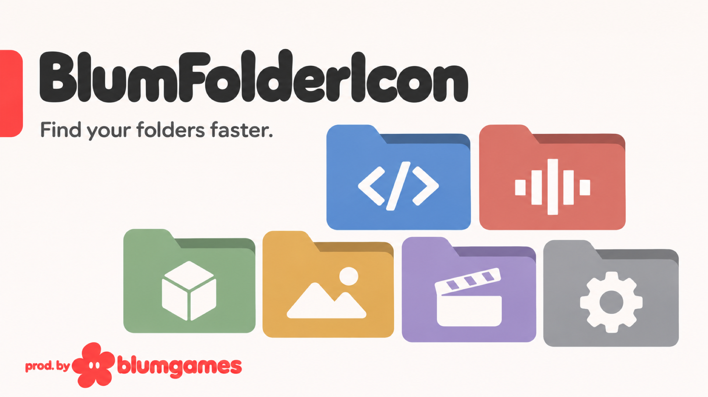
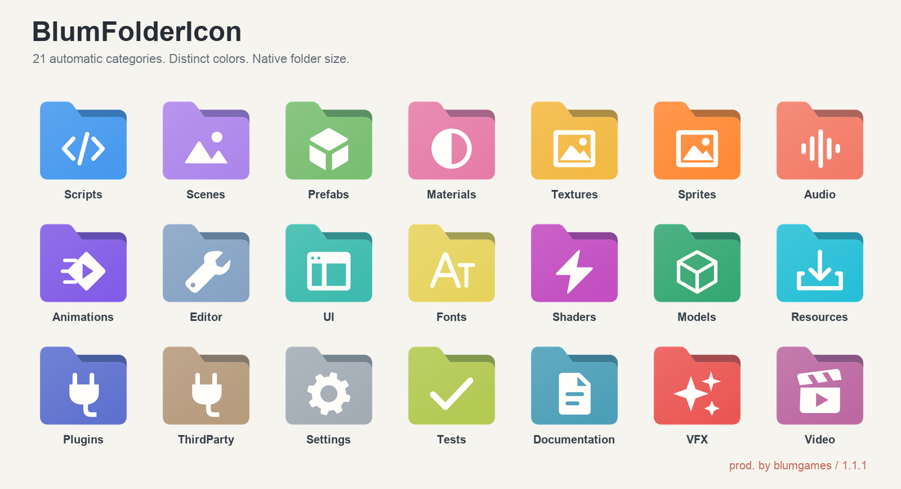

# BlumFolderIcon



**Find your folders faster.** Colorful folders and clear symbols for the Unity Project window, by **blumgames**.

Scripts, Audio, Prefabs and other familiar folders get their own look as soon as you install the package. Customize any folder without renaming it or changing its contents.

[Download .unitypackage](https://github.com/Betoraf/BlumFolderIcon/releases/latest) · [Report an issue](https://github.com/Betoraf/BlumFolderIcon/issues) · [MIT license](LICENSE.md)



## What you get

- **Automatic icons:** 21 editable name rules with distinct category colors, with singular/plural aliases and case-insensitive matching.
- **Your colors, your symbols:** 8 color presets, a color picker, 22 built-in symbols, and custom transparent PNGs.
- **Independent choices:** color only, symbol only, or both.
- **Per-folder customization:** stored by GUID, so it survives renaming and moving the folder, as long as its `.meta` file is preserved.
- **Bulk editing, Undo and Redo**, plus one-click reset to automatic or native Unity styling.
- **Light and dark themes**, Project tree, list and grid views.
- **Editor-only:** no runtime assembly, network requests, telemetry, or external dependencies.

## Updating

Install 1.1.1 over your existing copy using the same installation method. Project icons now match the visible size and padding of Unity's native folders. Unchanged automatic rules receive distinct category colors; Sprites and ThirdParty have separate rules. Per-folder overrides and customized rules are preserved.

When upgrading directly from 1.0, exact old color presets first migrate to the brighter 1.1 palette.

## Install

Choose **one** installation method. Do not install both copies in the same project.

### .unitypackage

1. Download **BlumFolderIcon-1.1.1.unitypackage** from [Releases](https://github.com/Betoraf/BlumFolderIcon/releases/latest).
2. Open it with Unity and import all files.
3. Your standard folders are styled automatically.

### Unity Package Manager

Open **Window → Package Manager**, choose **Add package from git URL**, and paste:

```text
https://github.com/Betoraf/BlumFolderIcon.git#v1.1.1
```

Git must be installed on your computer for Package Manager's Git installation.

## Customize a folder

1. Select one or more folders in the Project window.
2. Right-click → **BlumFolderIcon → Customize**.
3. Choose a color and symbol, then click **Apply**.

You can also open **Tools → Blumgames → BlumFolderIcon** and select folders while the window is open.

**Custom PNG** adds your image as the folder's centered symbol, keeping its original colors. A transparent, square image with a simple silhouette works best. The texture does **not** need Read/Write enabled.

**Reset to Automatic** removes your override and uses the matching name rule again. **Use Unity Default** explicitly keeps that folder native, even if its name matches a rule.

## Automatic rules

Click **Automatic rules** in the customization window. Each rule has a list of comma-separated folder names, a color and a symbol. Matching is exact, ignores letter case and does not match partial names. If two rules contain the same name, the first enabled rule wins.

Priority: **per-folder style → automatic name rule → Unity default**.

Turn off **Automatic icons** to keep only your manual styles. Turn off **Enabled** to return the entire Project window to its native appearance without deleting any settings.

## Shared settings

Settings are saved in:

```text
ProjectSettings/BlumFolderIcon.asset
```

Commit this file with your project's folder `.meta` files and any custom PNG assets. The package never writes your preferences into `Packages` or `Library/PackageCache`, so package updates preserve them. Restart Unity after pulling settings changed by another team member.

The settings file is created only after you change a setting. Deleting a folder does not automatically discard its saved style, so restoring that folder and its original `.meta` also restores its appearance.

## Compatibility

Requires **Unity 2022.3 or newer**. Tested on **2022.3.62f3** and **6000.3.27f2** on macOS. Other Editor versions and operating systems have not been individually verified.

BlumFolderIcon decorates folders in the **Project window**, not operating-system folders, the Hierarchy, or the Inspector. Colored folders use original layered artwork with a darker rear tab, fitted to the native folder bounds at each Project-window icon size. The native Unity appearance remains available through **Use Unity Default**. Unity version-control badges remain Unity's responsibility.

Use one folder-styling extension at a time. Two packages drawing over the same Project icon can overlap.

## How it works

A public Project-window callback draws cached folder textures. Folder lookups, rules and generated icons are cached; repainting an already-seen folder does not scan the filesystem or regenerate its texture. No reflection into Unity's Project Browser internals is required.

The customization window uses UI Toolkit. All code is contained in the `Blumgames.FolderIcon.Editor` assembly, excluded from player builds. Folder artwork and all 22 symbols are original. The repository includes matching SVG sources in `Artwork~`; the Editor loads the PNG assets once and caches the tinted results.

## Credits & license

Created by **blumgames**. Free to use and modify, including in commercial projects, under the [MIT license](LICENSE.md). Keep the copyright and license notice when redistributing the source.

Inspired by the usefulness of [SimpleFolderIcon](https://github.com/SeaeeesSan/SimpleFolderIcon). This is an independent implementation, not a fork or an official Unity product.
